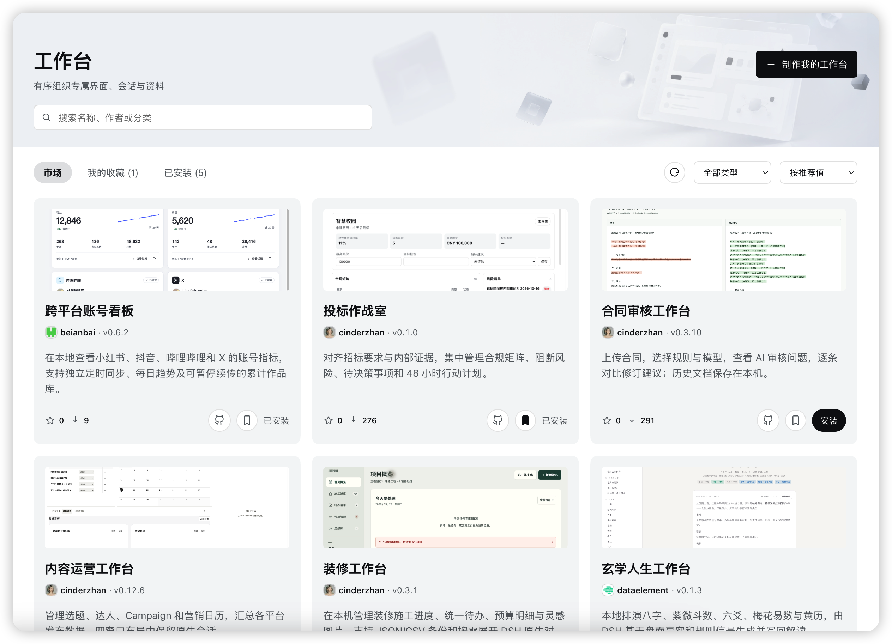
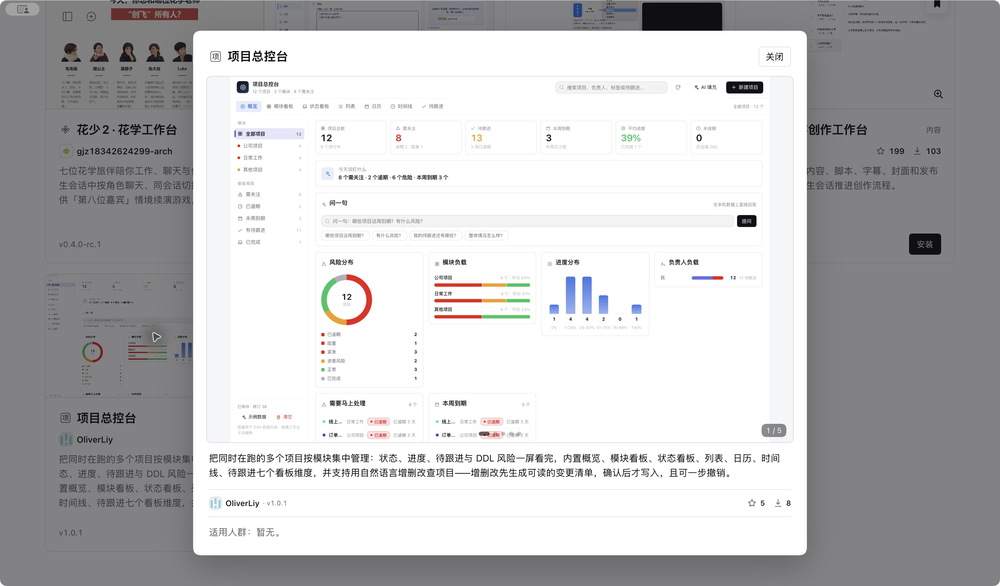

<div align="center">

# Awesome DSH Workbench

**发现、安装和分享 DSH Desktop 社区工作台。**

把项目管理、内容创作、运营分析和生活工具，放进你的 AI 桌面。

[获取 DSH Desktop](https://dshdesktop.com) · [浏览工作台目录](data/workbenches) · [提交你的工作台](CONTRIBUTING.md)

[](https://github.com/dataelement/awesome-dsh-workbench/actions)
[](https://github.com/dataelement/awesome-dsh-workbench/actions/workflows/build-catalog.yml)

</div>



<p align="center"><sub>DSH Desktop 工作台市场界面</sub></p>

## 找到适合你的工作台

工作台将一个具体任务需要的界面、资料与操作集中在一起，让你在 DSH Desktop 中开展工作。社区工作台围绕效率、内容、运营、调研等场景展开。

下面是一些可以开始探索的工作台；完整条目见[目录](data/workbenches)，当前可安装版本以客户端市场为准。

| 工作台 | 适合做什么 |
| --- | --- |
| [项目总控台](https://github.com/OliverLiy/projectHub) | 集中查看多个项目的进度、待跟进事项和截止日期风险 |
| [跨平台账号看板](https://github.com/beianbai/cross-platform-account-dashboard) | 查看多个内容平台的账号指标、每日趋势和作品库 |
| [产品更新追踪](https://github.com/wisdomqin/product-update-tracker) | 用月历与中文日报跟踪 GitHub 仓库和公开网页的变化 |
| [Oil 内容创作工作台](https://github.com/oil-oil/dsh-oil-creator) | 管理视频脚本、字幕、封面和发布状态 |
| [合同审核工作台](https://github.com/cinderzhan/dsh-contract-review-workbench) | 查看 AI 审核问题，逐条比较合同修订建议 |
| [投标作战室](https://github.com/cinderzhan/dsh-bid-workbench) | 对齐招标要求、合规证据、风险和行动计划 |
| [门店选址](https://github.com/dataelement/dsh-site-selection) | 在三维城市地图上比较候选点位，记录踩点与选址决策 |
| [装修工作台](https://github.com/cinderzhan/dsh-zhuangxiu-workbench) | 在本机管理施工进度、待办、预算和灵感图片 |

## 从市场开始

1. 安装并打开 [DSH Desktop](https://dshdesktop.com)，进入工作台市场。
2. 按分类浏览工作台，打开详情查看截图、介绍与作者仓库。
3. 选择安装，按客户端提示完成操作；安装变更需要重启时，重启后生效。
4. 在工作台中开始使用。更新时刷新市场，并按提示安装新版本。



<p align="center"><sub>项目总控台详情 · 2026-10-13 实拍；画面中的版本与状态为当时快照</sub></p>

使用前请查看作者 README 中的运行环境、权限、外部服务费用和已知限制。收录与自动检查不等于完整安全审计，也不代表所有系统和 Desktop 版本都已经验证。

## 分享你的工作台

源码、安装包、截图与使用说明保留在你的公开仓库；这里只维护市场目录信息。

1. 按目标 Desktop 的真实工作台接口开发，从最终安装来源在本机验证安装、打开与基本功能，并拍摄截图。
2. 复制 [YAML 示例](examples/workbench.yml)，替换占位内容，保存为 `data/workbenches/<owner>__<repo>.yml`。
3. 在本仓库运行检查，从 fork 提交 PR，只新增或修改这一份工作台 YAML。
4. 在 PR 中提供实测环境、最终安装来源、截图证据、权限与费用说明。自动检查和维护者审核通过后合并，目录发布成功后进入市场。

```sh
npm ci --ignore-scripts
npm run check
```

最小目录条目如下，仓库和截图地址均需替换为真实内容：

```yaml
url: https://github.com/owner/repo
name: 项目助手
nameEn: Project Assistant
category: productivity
description:
  zh: 帮助整理项目资料、跟进任务并生成工作报告。
  en: Organize project materials, track tasks, and generate work reports.
screenshots:
  - https://raw.githubusercontent.com/owner/repo/main/docs/images/overview.webp
```

不需要手填 ID、版本、commit、npm 包名或校验值。需要指定 GitHub Release 安装包时，可增加 `tarball`。完整要求见[投稿指南](CONTRIBUTING.md)和[目录字段与图片标准](catalog/README.md)。

## 版本如何进入市场

目录按 **npm → 明确声明的 GitHub Release → 源码** 选择安装来源，并固定实际版本与校验信息。作者正常发版后，目录每日定时重新探测；修改名称、介绍、分类或截图地址等目录信息时，需要更新 YAML 并提交 PR。

- **npm**：跟随通过校验的 `latest` 版本。
- **Release**：`tarball` 使用 `latest/download/<资源名>` 时跟随最新发布；固定 tag 地址需要通过 PR 更新。
- **源码**：跟随默认分支，发布时固定当次 commit。

**PR 合并不等于立即上线。** 合并后还需市场目录发布成功；机器人合并会主动触发发布。若探测或发布失败，市场保留上次成功目录。客户端已安装的工作台仍需按更新提示操作。

[GitHub Actions 发布记录](https://github.com/dataelement/awesome-dsh-workbench/actions/workflows/build-catalog.yml) · [公开市场索引](https://market.dshdesktop.com/index.json)

## 贡献与维护

欢迎投稿新工作台、完善介绍与截图，或报告目录和安装问题。安装后的功能问题优先反馈到作者仓库；目录展示、收录和发布问题可在[本仓库 Issues](https://github.com/dataelement/awesome-dsh-workbench/issues)反馈。

| 文档 | 内容 |
| --- | --- |
| [投稿指南](CONTRIBUTING.md) | 首次收录、后续维护、PR 范围与审核材料 |
| [目录协议](catalog/README.md) | YAML 字段、截图、安装来源与包要求 |
| [发布运行手册](docs/operations.md) | 自动发布、巡检、失败处理与回滚 |
| [内容与安全审核](docs/security-review.md) | 审核范围、证据要求与处理流程 |

感谢每一位分享工作台、提交反馈和参与维护的社区贡献者。
